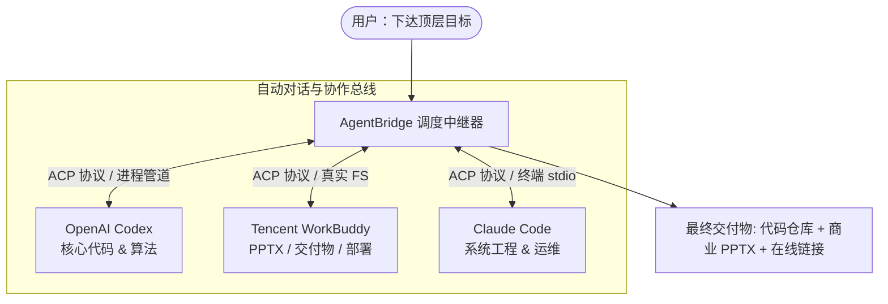

# AgentBridge 🌉

> **告别充当 AI 的“人肉剪贴板”** —— 跨智能体全自动对讲、辩论与任务协同调度中继器。  
> Universal Autonomous Multi-Agent Relay & Orchestration Bridge for **Codex**, **WorkBuddy**, **Claude Code**, and CLI Agents.

---

## 🌟 为什么需要 AgentBridge？

现在的开发者和团队往往同时运行着多个不同厂商的 AI 智能体：
- **OpenAI Codex**：擅长核心算法设计、底层代码编写与语法级重构；
- **Tencent WorkBuddy**：擅长高保真 Office 文档（PPTX/Word/Excel）、多媒体生成与在线网页部署；
- **Claude Code / Gemini**：擅长系统级统筹、终端命令执行与测试排查。

**痛点**：它们各自生活在不同的窗口和沙箱中。每当你想让 A 写代码、B 审查、C 做汇报时，你必须在不同窗口之间**一遍又一遍地复制粘贴**，人工充当低效的“AI 搬运工”。

**AgentBridge 解决的核心问题**：
通过本地 CLI 适配器、ACP 结构化协议与事件调度总线，**让多个独立的 Agent 能够像在会议室开会一样，全自动直连对讲、多轮交锋并形成最终交付物，无需任何人工搬运！**

---

## 🏗️ 架构图解



---

## ✨ 核心特性

- 🚀 **Zero-Clipboard（零剪贴板）**：告别人工复制粘贴，进程级/协议级直连自动运转。
- 🔌 **多适配器架构（Adapters）**：
  - `CodexAdapter`：基于 OpenAI Codex CLI (`codex exec`)
  - `WorkBuddyAdapter`：基于 Tencent WorkBuddy / CodeBuddy（兼容 ACP 规范与真实 FS 共享）
  - `ClaudeCodeAdapter`：基于 Anthropic Claude Code CLI (`claude -p`)
  - `MockAgentAdapter`：用于离线演示与自动化 CI 单测
- 📜 **标准协议保障（ACP Ready）**：严格遵循结构化 Agent 通信协议（Ask、Reply、Introduce、Checkpoint），上下文自动裁剪，防信息过载。
- 🎭 **双重协作模式**：
  - **Debate / Chat 模式**：双 Agent 围绕同一议题自主交锋、互相提问，并在 N 轮内达成共识。
  - **Pipeline 模式**：串行流水线作业（Agent 1 产出中间数据 -> Agent 2 消费生成文档）。
- 💻 **优雅可视化终端**：基于 Rich 构建，实时彩色流式渲染每位 Agent 的头像、身份、思考过程与交付物。

---

## 🚀 5 秒快速开始

### 1. 安装依赖

```bash
git clone https://github.com/your-username/agent-bridge.git
cd agent-bridge
pip install -r requirements.txt
```

### 2. 探测本机已安装的 Agent

```bash
python -m agent_bridge.cli list
```

终端将自动探测你电脑上已安装并可直接调用的 Agent：
```text
┌─────────────────┬─────────────────┬────────────┬────────────────────────────┐
│ Agent 标识      │ 适配器类型      │  可用状态  │ 检测到路径 / 详情          │
├─────────────────┼─────────────────┼────────────┼────────────────────────────┤
│ Codex           │ codex           │   已就绪   │ AppData\Local\Programs\... │
│ WorkBuddy       │ workbuddy       │   已就绪   │ D:\software\WorkBuddy\...  │
│ ClaudeCode      │ claude_code     │   已就绪   │ AppData\Roaming\npm\...    │
│ MockAgent       │ mock            │   已就绪   │ 演示与自检适配器           │
└─────────────────┴─────────────────┴────────────┴────────────────────────────┘
```

### 3. 一键开启双机自主对讲

```bash
# 启动 Codex 与 WorkBuddy 围绕议题进行 2 轮自主交锋
python -m agent_bridge.cli chat --agent1 codex --agent2 workbuddy --topic "设计一套本地价格表自动化分析系统"
```

你将在屏幕上实时看到两位 Agent 一来一回自动推演方案，无需动一次鼠标！

---

## 🐍 Python 代码调用示例

```python
from agent_bridge import AgentOrchestrator, get_adapter

# 1. 初始化适配器
codex = get_adapter("codex")
workbuddy = get_adapter("workbuddy")

# 2. 启动编排器
orchestrator = AgentOrchestrator(console_output=True)

# 3. 运行多轮辩论与对讲
history = orchestrator.debate(
    agent_a=codex,
    agent_b=workbuddy,
    topic="如何把一个静态 HTML 价格表自动化转化为带利润测算的 PPTX 招商演示？",
    rounds=2
)
```

---

## 📁 项目目录结构

```
agent-bridge/
├── agent_bridge/           # 核心代码包
│   ├── adapters/           # 智能体客户端适配器
│   │   ├── base.py         # 抽象基类
│   │   ├── codex.py        # OpenAI Codex 适配
│   │   ├── workbuddy.py    # Tencent WorkBuddy 适配
│   │   ├── claude.py       # Claude Code 适配
│   │   └── mock.py         # 离线自检模拟器
│   ├── protocols/          # 协议解析层
│   │   └── acp.py          # ACP 协议序列化与解析器
│   ├── models.py           # Pydantic 消息模型
│   ├── orchestrator.py     # 对讲编排与流水线引擎
│   └── cli.py              # 命令行交互入口
├── examples/               # 快速入门示例
├── pyproject.toml          # 打包配置文件
├── requirements.txt        # 轻量依赖清单
├── LICENSE                 # MIT 开源协议
└── README.md               # 项目使用文档
```

---

## 🛣️ 路线图 (Roadmap)

- [x] 原生支持 OpenAI Codex、Tencent WorkBuddy 与 Claude Code
- [x] 支持 ACP (Agent Communication Protocol) 标准消息格式
- [x] 多轮双机对讲 (Debate) 与串行流水线 (Pipeline)
- [ ] 支持基于 A2A (Agent2Agent) HTTP 规范的原生网关服务
- [ ] 增加 Web UI 看板，可视化观察 Agent 之间的通信拓扑与气泡流
- [ ] 支持更多主流 Agent 接入（如 Cursor CLI、Windsurf 等）

---

## 📄 开源许可证

本项目采用 [MIT 许可证](LICENSE)。欢迎提交 Issue 与 Pull Request！
